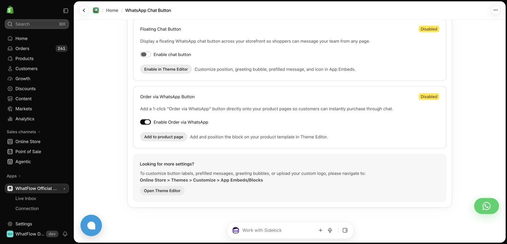

A free WhatsApp button is a useful start. The more revealing WhatFlow versus Dondy comparison begins when you want the next step: an order message, a shared inbox for replies and a workflow someone on the Shopify team can maintain.

I would choose WhatFlow Business API for that progression. Theme-matched WhatsApp buttons are free forever, and all available product features stay included across messaging plans, including Free. The inbox has no seat fees. You can change sending capacity without buying a larger edition to unlock another feature.

## Separate the button from the messaging platform

Dondy's [Shopify App Store listing](https://apps.shopify.com/dondy-marketing-ai), checked October 27, 2026, lists a free button offering, Pro at $6.99 per month, Power Automation at $79.99 and Elite at $159.99. The listing describes official API, inbox and marketing in Power Automation; Elite lists AI, five agents and unlimited flows. Additional usage charges apply.

Those are different package scopes. The button price alone cannot answer what the automated workflow costs. Conversely, a store that only needs a contact button should not assume it must buy an automation package immediately.

WhatFlow's own button is also distinct from message capacity. Free-forever buttons do not mean unlimited free automated sending. Check [WhatFlow's current allowances and rates](/pricing) for the official Business API app and add applicable Meta charges.

## Decide which features are launch requirements

Write down the next concrete job rather than comparing every advertised function. For example: send a supported order update, let the buyer ask a delivery question and involve the warehouse colleague who can check it.

With WhatFlow, the available automation, inbox and catalog capabilities are included across plans. Shopify extensions and Flow integration are part of the product's store-focused design. You do not need to buy a higher feature edition because the customer question becomes more involved.

Dondy is also a Shopify product, and its Shopify fit deserves to be evaluated directly. Ask which current package supports your required event, the relevant message and the actual people answering the reply. Do not assume the capabilities listed for Elite are included in Pro, or infer the opposite without checking.

If you need AI assistance now, record that separately. WhatFlow's AI is unavailable today. An AI requirement should influence the shortlist honestly rather than disappear inside an “all features” claim.

## Walk through a delayed parcel without sending anything

Prepare a fictional order with two parcels, one delivered and one delayed. Draft the initial update and the customer's follow-up. Then ask a colleague to explain how they would check the affected parcel and record the next promised contact.

Use inactive workflows and sample values. The exercise should establish:

- Which field supplies the tracking destination?
- Can the operator identify the parcel behind the reply?
- Who is responsible for the carrier check and customer follow-up?
- Does that colleague require an additional paid entitlement in the proposed plan?

Our [shipping-delay guide](/blog/whatsapp-shipping-delays-shopify) includes sample replies and a handoff record. The test requires no customer messages, live order changes or prediction about how quickly a carrier will respond.

WhatFlow's no-seat-fee inbox makes occasional warehouse participation easier to budget. It still needs a clear owner. Shared access alone does not complete the investigation.

## Compare the first useful month and the busy month

Ask for two budgets: the expected launch volume and a plausible peak month. Include the exact package, applicable usage rates, tax, Meta charges and any separately purchased service. Confirm whether the staffing and flow assumptions still hold at the higher volume.

WhatFlow's available features remain the same as the message plan changes. That makes the capacity question easier to separate from the feature question. Dondy's package structure should be evaluated using its actual listed inclusions, rather than an invented universal seat charge or a claim that it lacks an inbox.

The [Shopify app-cost checklist](/blog/audit-shopify-app-costs-feature-gates-seat-fees) helps capture the complete proposal instead of relying on a headline monthly number.

Actual demo-store button settings, with theme embeds disabled. Styling and placement are configured in Shopify Theme Editor.

## Keep product identity and company news in perspective

This comparison is about WhatFlow Business API, which uses the official Meta Cloud API. WhatFlow Chat Automation is the separate linked-device app. Their connection methods, intended use and reviews should not be combined. The [two-app comparison](/compare/whatflow-chat-automation-vs-business-api) explains that distinction.

For Dondy, ask directly about current support commitments, product ownership and the roadmap items relevant to your store. Company news alone does not establish a future price rise, service decline or uncertain direction. A useful purchase decision rests on the terms and capabilities available now.

For a Shopify store moving beyond a button, WhatFlow has a strong present-day case: official API messaging, native store workflows, a serious inbox and consistent feature access without seat fees. Start there, then compare Dondy's required package against the same order-and-reply task.
