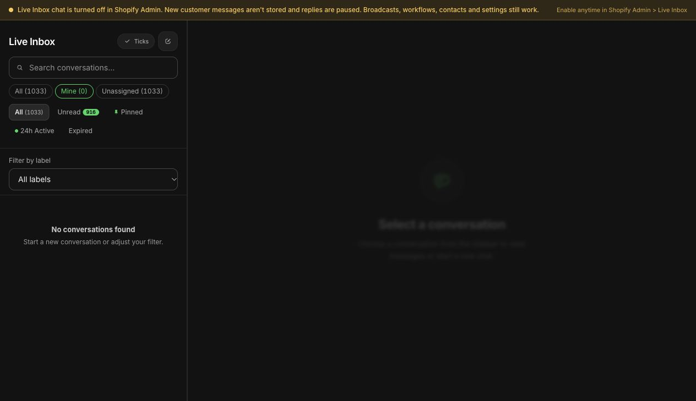

Choose WhatFlow Business API first when your team needs Shopify WhatsApp operations: an order message, a useful customer reply, product help and a shared inbox. It is built around Shopify extensions and Flow integration, with all available features included across messaging plans and no inbox seat fees.

respond.io is a broader conversation platform with omnichannel and AI scope. That can be valuable when the business has a defined cross-channel sales or service process. For a Shopify store, the decision is whether you need that wider operating model and how its active-contact billing matches the workload.

## A monthly active contact is not a sent message

respond.io's [pricing page](https://respond.io/pricing/), checked October 27, 2026, uses monthly active contacts as a core usage measure. A store's number of outbound messages cannot simply be placed into that allowance as if the units were interchangeable.

Consider a hypothetical month with 500 customers. Some receive one order update; others exchange several messages with support. The customer count, outbound send count and support-case count describe different things. To price respond.io, ask which of those people meet its current monthly-active-contact definition and how usage resets. To price WhatFlow, apply its actual messaging allowance and rate to the relevant sends.

Also separate each provider's usage from Meta delivery pricing. Neither a contact allowance nor an app-side send allowance establishes that all WhatsApp charges are included. Keep the [current WhatFlow plans](/pricing) and the provider's quote beside the same workload forecast.

## Read the billing period before comparing the headline

The respond.io pricing page presents a $79-per-month Starter figure alongside $948 annual billing. That is an annual-billing equivalent, not a verified month-to-month price. Ask for the actual billing commitment before comparing it with another application's monthly subscription.

Its page also describes a seven-day trial without a credit card. Use a trial or written demonstration to establish the required scope, then confirm the package, contact allowance, team access and any AI-related usage you would purchase. Do not assume the entry package includes every workflow advertised across the site.

For WhatFlow, available features are included across plans, including Free, while messaging allowances and rates differ. There are no inbox seat fees. This keeps feature access and staffing out of the capacity-upgrade decision, although it does not remove applicable messaging costs.

## Decide who owns the daily customer record

An organization qualifying leads across channels may want a conversation platform as the staff's primary workspace. A Shopify support team may instead organize the day around orders, fulfillment and product questions. Work out which process you need before choosing the interface that looks more extensive.

WhatFlow fits the second pattern closely. The team can build around available Shopify events, message triggers and Flow actions alongside other store apps. The [connector evaluation guide](/blog/evaluate-shopify-app-workflow-connectors) helps check the specific source, field and action behind a proposed workflow.

respond.io deserves a closer look when the team will use its omnichannel or AI capabilities for a maintained process. WhatFlow currently has no AI. Do not buy WhatFlow on the assumption that a future feature is available, and do not buy a larger platform solely because the demonstration contains tools your store will not use.

## Test a returning customer across two months

Create a fictional customer timeline with a purchase near the end of one month and a support question in the next. Add several messages and a product inquiry. No live messaging is required.

Ask each proposed setup to explain the customer identity, relevant Shopify order and billing treatment in each period. Then ask a colleague to take over the support question using only the available record. They should know the issue, the next action and the next promised customer update.

For respond.io, get a written explanation of the active-contact and package treatment. For WhatFlow, apply the sending model and inspect the supported Shopify context. Keep any manual lookup visible rather than treating a contact record as proof that every relevant order field is synchronized.

The [shared inbox guide](/blog/shared-team-inbox-small-shopify-business) provides a practical handoff standard. The [catalog-sharing guide](/blog/shopify-whatsapp-catalog-support) adds a useful product question to the same exercise.

Actual demo-store inbox with Mine selected and no assigned conversations displayed. Inbox chat is off in this demo; counts are not a merchant case study.

## Choose the operating model your team will maintain

I would select WhatFlow for a Shopify team seeking a focused WhatsApp layer with native store integration, a serious inbox and flexible team participation. Its all-features model makes it easier to expand the workflow without another feature edition or seat bill.

Select respond.io for further evaluation when its verified cross-channel and AI scope solves an actual business requirement. Compare the complete proposal, annual commitment and active-contact forecast with that benefit. For either product, the strongest evidence is a workflow a colleague can explain and maintain after the implementation call ends.
