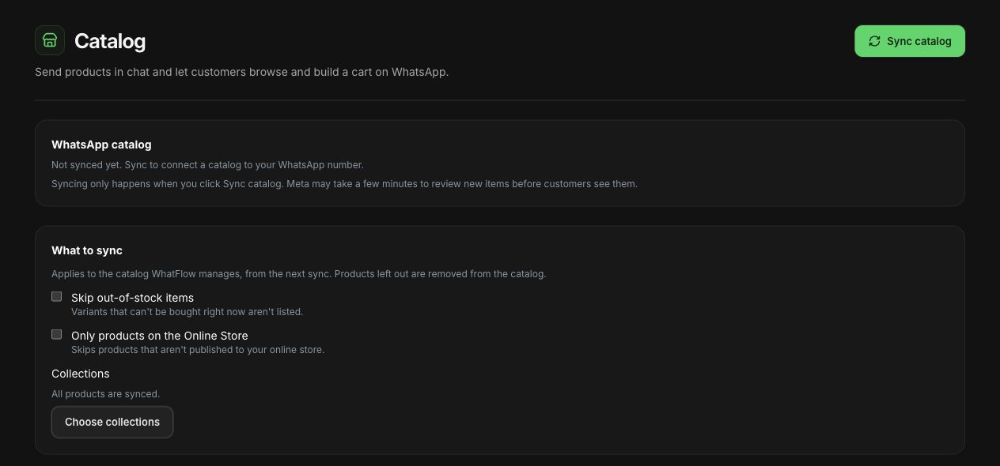

# Use WhatsApp catalog sharing for Shopify support

WhatFlow Business API supports catalog sharing today. An agent can show a relevant product inside a WhatsApp conversation while helping the customer choose. The useful starting point is the question: which size, which replacement part or which of two products actually fits the customer's needs?

I would rather send one well-chosen item with an accurate explanation than a large catalog and leave the buyer to start again. Our [product recommendation guide](https://whatflow.tech/blog/helpful-cross-sell-product-recommendations) covers that judgment. This guide focuses on preparing the catalog, sharing the right item and keeping availability and purchase details accurate.

> **Key Takeaways**
>
> - Catalog sharing is live in WhatFlow Business API.
> - Check who manages the connected catalog before changing or syncing products.
> - Verify the exact variant, current availability and compatibility before recommending it.
> - A shared product or submitted cart is not proof of payment or a completed Shopify order.

## Know which catalog you are using

WhatFlow distinguishes a catalog it manages from an existing catalog already connected to your WhatsApp number. That difference determines where you maintain the products.

For a WhatFlow-managed catalog, the Catalog screen's **Sync catalog** action copies active Shopify products, with an item per variant, and removes deleted products. The available sync settings can also exclude products. Review those settings before changing the catalog's scope: excluded items are removed on the next sync.

For an existing connected catalog, WhatFlow reads it without changing its products. Maintain those items in the system that owns the catalog, such as the Shopify Facebook & Instagram channel, rather than assuming a WhatFlow sync will overwrite it.

The current Catalog screen explicitly says synchronization happens when you click **Sync catalog**. Do not treat the last synchronization as a guarantee of live inventory. Check important price or stock changes at their source before making a promise to the buyer. New or rejected items also need review before you rely on them in support.

These product details were checked against WhatFlow's catalog and product-message implementation on October 27, 2026. Screen wording can change as the product develops.

Actual WhatFlow demo-store catalog settings, captured October 27, 2026. The catalog has not been synced in this demo. The image shows available controls, not a completed sync or sent product message.

## Prepare a small, useful test set

Start with a few products your team regularly discusses. Choose two variants of a familiar item and a compatible accessory. Verify the image, product name, variant, price and destination before anyone uses them in a customer conversation.

Use a test conversation with an authorized colleague. Ask them to open the product and explain what they believe they are selecting. A card that technically sends can still be confusing if several variants share an indistinguishable name or image.

| Item to check | Support risk | Useful test |
| --- | --- | --- |
| Variant name | Buyer chooses the wrong size or color | Ask the colleague to identify the variant without your help |
| Product image | Similar products look interchangeable | Compare the image against the actual item being recommended |
| Price | Old catalog value becomes a sales promise | Compare the displayed amount with the current store source |
| Availability | A recommendation implies stock is reserved | Check stock and explain whether anything has been reserved |
| Product suitability | A card is mistaken for compatibility advice | Verify the customer's model or requirement first |

Keep a fallback ready. If an item is missing or inaccurate, use a verified storefront product link while the catalog is corrected. Do not send a similar-looking variant just to avoid interrupting the conversation.

## Answer the product question before sending the product

Our guide to [pre-purchase WhatsApp questions](https://whatflow.tech/blog/product-questions-whatsapp-prepurchase-support) explains how to turn recurring questions into better product information. Ask the smallest clarifying question that changes the recommendation. For a replacement part, that might be the product model. For clothing, it could be a measurement from the published size guide. Do not ask for unnecessary personal information.

Consider this fictional exchange:

> Customer: Will this strap fit the bag I bought last year?
>
> Agent: Which bag model do you have? The current strap fits the Compact 2, but I need to check the original Compact separately before recommending it.

After confirming compatibility, the agent can share the exact item:

> This is the strap listed for your Compact 2. I've selected the black version you asked about. Please check the product details before purchasing; tell me if you want to compare the other color.

If compatibility remains unclear, keep it unclear in the answer. A polished product card does not establish that the item fits.

## Choose the smallest useful product message

WhatFlow's product-sharing interface includes **One product**, **Product list**, **Carousel** and **Whole catalog** options. Use the format that fits the conversation, rather than the one that shows the most inventory.

For a specific replacement part, one product is usually enough. For a customer comparing two suitable items, a small selection keeps the choice manageable. A whole catalog makes more sense when the customer asks to browse the range.

In the **Send products** interface, select the intended format, choose the relevant catalog item or items and review the accompanying message before sending. The available fields vary by format. For a product list, the heading and sections should help the customer understand the selection, such as “Compatible straps” and “Matching accessories.”

Keep free-form product messages inside the applicable WhatsApp service window. The [WhatsApp Business Messaging Policy](https://business.whatsapp.com/policy) explains that the 24-hour window follows the user's last message and that approved templates are required outside it. Respect opt-in and opt-out requirements as well. Policy checked October 27, 2026.

## Explain what happens after a cart arrives

Where enabled, customers can send a catalog cart containing selected items and quantities. Treat that as a purchase request to review. Confirm the intended variants, current availability and the next step in your store's actual order process.

Do not tell the customer they have paid or received a confirmed Shopify order simply because they shared a cart. Use the verified checkout or authorized order-creation process your store supports. Make any final shipping cost, tax or other required charge clear at the appropriate step.

An accurate reply might be:

> I've received your selection of two black straps. I'll check availability and confirm the purchase step before you pay. Sending this cart hasn't reserved the items or completed payment.

That small clarification prevents a support conversation from creating a false order confirmation.

## Keep useful help easy to hand over

Record the requirement that led to the recommendation, not just the item sent. A colleague should be able to see that the customer wanted a Compact 2 strap in black and that no stock reservation was promised.

WhatFlow combines catalog sharing with an enterprise-ready team inbox, without AI or inbox seat fees. All available features are included across plans, including Free; messaging allowances and rates differ, and applicable Meta charges are separate. The practical advantage is that a product specialist can help with the same customer conversation without adding a seat charge. Follow the [inbox handoff process](https://whatflow.tech/blog/shared-team-inbox-small-shopify-business) so that shared access also produces clear ownership.

## Check recommendations after product changes

When the store changes a product, price or variant, review the catalog and any saved answers that mention it. Add a simple check to the team's routine: source updated, appropriate sync completed, customer-facing item reviewed.

The best first rollout is a narrow one: a verified catalog, a few common questions and a team that understands the purchase handoff. Once those work, expand the range. Catalog sharing is most valuable when it helps the buyer make the right decision with less back-and-forth.

## About the author

Safwan Adnan is co-founder and CEO of [WhatFlow](https://whatflow.tech/about). The customer exchanges above are illustrative, not merchant testimonials. [Contact our team](mailto:support@whatflow.tech) for help with catalog sharing in your Shopify WhatsApp setup.
