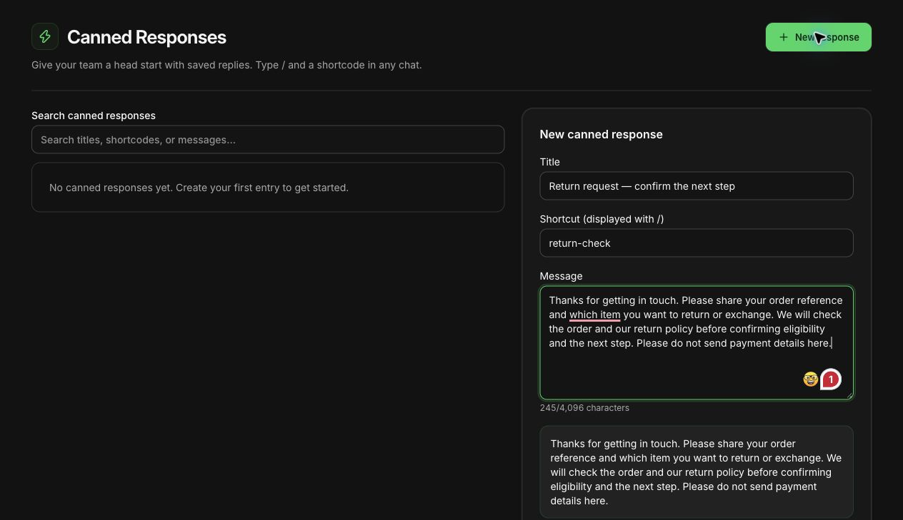

# Handle Shopify returns and exchanges on WhatsApp

WhatsApp can make a return conversation easier for the customer: they can explain the problem and ask a follow-up in the same thread. The actual return, exchange and refund still need to be handled in Shopify or your configured returns system by someone with the appropriate authority.

I would build the process around that distinction. A friendly reply should move the case forward without making an approval, stock or payment promise that the store has not checked. Start with [clear inbox ownership](https://whatflow.tech/blog/shared-team-inbox-small-shopify-business), then give the team a dependable path from request to resolution.

> **Key Takeaways**
>
> - Verify the order, item and applicable policy before promising eligibility.
> - Treat a return request, approval and refund as separate events.
> - Keep sensitive information and payment processing out of the chat.
> - Use WhatFlow for the conversation and your authorized Shopify process for the order action.

Actual WhatFlow demo-store reply editor with an illustrative, unsaved return-support draft. No customer message was sent and the draft was discarded.

## Publish a policy the support team can apply

Give agents the current returns policy and a way to check which terms apply to the customer's purchase. Record the return window, excluded products, item-condition requirements, who pays return shipping and the available resolution options. Product faults or other protected situations may need a different review; do not turn a generic saved reply into a blanket legal conclusion.

Explain the process plainly. Customers need to know where to start, what happens after a request and when an approved refund is actually issued. If the policy allows exchanges only after inspection, avoid a greeting that promises an immediate replacement.

Shopify supports [self-serve return requests](https://help.shopify.com/en/manual/fulfillment/managing-orders/returns/self-serve-returns) from the order status page when configured. A request still needs the merchant's review. Offer the store's actual self-serve route where available, with WhatsApp as a place to resolve questions rather than forcing a second request into another system.

## Ask for the minimum information needed

Identify the order and the affected item through your established verification process. An order number helps find a record; it does not by itself establish that the person messaging owns it. Avoid exposing an address, full order history or other personal details before the appropriate checks.

A first reply might read:

> Hi Sara, I can help with that. Which item would you like to return, and is the issue fit, damage or something else? Please use [store's verified order-support route] so we can check the order securely. You don't need to send card details or identification documents here.

This is illustrative copy. Replace the bracketed route with a real, reviewed destination. If a photo is needed to assess damage, say what should be visible and ask the buyer to leave out labels or unrelated personal information. Do not request photos out of habit when the decision does not require them.

## Separate each decision in the conversation

Tell the buyer which stage the case has reached. A vague “all sorted” is easy to misunderstand when the parcel has not been returned or a payment has not been processed.

| Stage | What to verify | What the agent can accurately say |
| --- | --- | --- |
| Request received | Right order and item, request recorded | “We've received your request and will review it.” |
| Eligibility reviewed | Applicable policy and decision authority | “Your return is approved under the confirmed terms.” |
| Instructions issued | Actual return destination, label or process | “Please follow these return instructions.” |
| Return received | Warehouse or returns-system confirmation | “We've received the item; inspection is pending.” |
| Resolution completed | Actual refund or exchange action | “The refund has been issued,” only after checking it was |

Shopify's [return management guidance](https://help.shopify.com/en/manual/fulfillment/managing-orders/returns/creating-returns) describes creating and managing the return, including shipping instructions and applicable exchange or refund details. WhatFlow does not perform those operations merely because the customer requests them in chat. Shopify guidance checked October 27, 2026.

## Write an exchange reply that preserves the customer's choice

Confirm the requested variant and check stock before offering an exchange. Include any confirmed price difference or shipping charge before the buyer commits. Do not substitute a different item because it happens to be available.

> Thanks, Sara. I've checked your request for the blue medium. It is available at the moment, but it has not been reserved. Your exchange needs approval under our returns process first. I'll confirm the next steps and any cost before you decide whether to proceed.

If the item is unavailable:

> The blue medium isn't currently available. I can show you the alternatives, or we can review the return options that apply to your order. I won't change the item without your confirmation.

WhatFlow's live catalog sharing can help an agent show a relevant alternative in the same conversation. That is useful when the customer asks to see another size, style or compatible product. Check the variant and current availability before sending it, and avoid turning a complaint into a pushy sales conversation.

## Make the internal handoff actionable

Keep one owner for the customer's next reply, even if a warehouse colleague or manager needs to make the decision. Record the request, checks completed, outstanding decision and next promised contact.

A practical handoff looks like this:

> Customer requests size exchange for one shirt. Order verified through the store's support process. Policy review pending with returns lead. No replacement reserved and no refund promised. Jamie will update the customer Thursday by noon.

WhatFlow Business API includes an enterprise-ready inbox without AI and without inbox seat fees. Involving another colleague therefore does not add a seat charge. The team still needs sensible access, a named owner and a clear record of the decision. Our [saved-reply guide](https://whatflow.tech/blog/customer-service-saved-replies-without-robotic-tone) explains how to keep reusable answers accurate without making them sound impersonal.

## Follow up without collecting payment details

Use the established Shopify or returns-system process for a balance payment, refund or replacement order. Do not ask the customer to paste card details, verification codes or bank credentials into WhatsApp. For payment questions, direct them to the store's verified checkout or support process.

For an approved refund that has not yet been issued, say exactly that. Once it has been issued, confirm the action and use the payment provider's actual timing guidance. Do not invent a universal “three-day” arrival promise for every payment method or country.

Apply the [WhatsApp Business Messaging Policy](https://business.whatsapp.com/policy) to follow-ups: respect opt-in and opt-out requirements; the service window runs for 24 hours after the user's last message, and messages outside it require an approved template. These examples are writing samples, not approved templates. Policy checked October 27, 2026.

## Test the awkward cases before a busy week

Run through a partial return, an unavailable exchange variant and a customer who changes their mind before the return arrives. Ask a colleague to take over using only the recorded handoff. They should know what the store has promised and what remains undecided.

All available WhatFlow features are included across plans, including Free. Messaging allowances and rates vary, and applicable Meta charges are separate. Start with the process your team can maintain, then use [Shopify Flow workflows](https://whatflow.tech/blog/whatflow-shopify-flow-whatsapp-automation-guide) where a verified event and supported action genuinely remove repetitive work.

The useful outcome is simple: the customer understands the next step, the team knows who owns it and the order record matches what the conversation says.

## About the author

Safwan Adnan is co-founder and CEO of [WhatFlow](https://whatflow.tech/about). Examples are illustrative support scenarios, not merchant results. [Contact the team](mailto:support@whatflow.tech) to discuss a Shopify WhatsApp support workflow.
