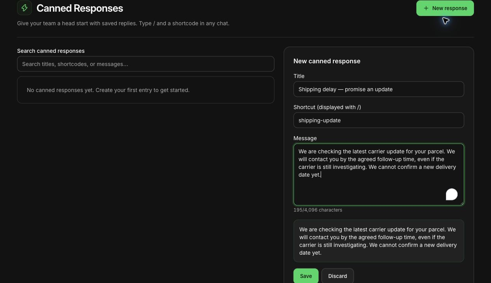

# Handle Shopify shipping delays on WhatsApp

A useful shipping-delay message tells the customer what you know, what you are checking and when they will hear from you again. It avoids turning a carrier estimate into a delivery guarantee. WhatsApp is particularly useful when the update becomes a conversation about a missing parcel, an address or a time-sensitive order.

The process below works with a small team and a manual tracking check. You can add automation once the underlying source and ownership are reliable. If you are choosing notification channels, our [WhatsApp versus SMS shipping comparison](https://whatflow.tech/compare/whatsapp-shipping-updates-vs-sms) covers that separate decision.

> **Key Takeaways**
>
> - Verify the affected parcel and tracking event before contacting the customer.
> - Promise a follow-up you control, rather than a delivery date you cannot guarantee.
> - Give the conversation an owner and keep the resolution separate from sending the update.

## Establish what actually happened

Open the order and identify the specific fulfillment, carrier and tracking number involved. A shipping label does not establish that a carrier has collected the parcel. An old scan does not establish that the parcel is lost. A split order can contain both a delivered parcel and one still in transit.

Record these facts before drafting a reply:

| Check | Record in the case | Avoid assuming |
| --- | --- | --- |
| Affected items | Which parcel contains which products | The whole order is delayed |
| Last reliable event | Carrier event and its timestamp | No new scan means no movement |
| Customer expectation | The delivery estimate or promise shown at purchase | Today's website estimate applied to this order |
| Next dependency | Carrier investigation, warehouse confirmation or customer information | Messaging the buyer resolves the dependency |
| Next contact | Named owner and a specific follow-up time | Someone else will pick it up |

Check the tracking destination itself before sending it. A replacement shipment may have a different link. Shopify describes where customers can [track fulfilled orders](https://help.shopify.com/en/manual/fulfillment/setup/order-status-page/order-tracking), including the order status page, shipping emails and Shop. If your carrier or fulfillment provider has supplied an explanation, preserve its uncertainty: “The carrier is investigating” is more accurate than “The parcel will arrive tomorrow.”

## Choose the correct WhatsApp sending route

Handle shipping updates as service communications tied to the customer's order. Keep product offers and unrelated promotions out of the delay message. Check the customer's permission and the current WhatsApp messaging rules before initiating contact; an order phone number alone is not a universal invitation to message.

With WhatFlow Business API, the relevant messaging route depends on the customer-service window and the applicable approved template. The [WhatsApp Business Messaging Policy](https://business.whatsapp.com/policy) describes a 24-hour service window after the user's last message; outside that window, use an approved message template. It also requires applicable opt-in and honoring opt-out requests. The same constraints matter when a workflow starts the message. Policy and Shopify guidance checked October 27, 2026.

When WhatsApp is unavailable or unsuitable for the customer, continue through an appropriate established support channel. The aim is to keep the buyer informed, rather than force every case into one channel. Our [channel coordination guide](https://whatflow.tech/blog/coordinate-email-sms-whatsapp-customer-messages) helps prevent duplicate notifications.

## Send a clear initial update

Use the customer's context and a concrete next step. The examples here are fictional writing samples to adapt after verifying the facts; they are not automatically approved WhatsApp templates.

**Carrier investigation, no new delivery date:**

> Hi Maya, your order #1042 is taking longer than expected. The carrier's last update was at the sorting facility on Monday. We've asked them to investigate. I'll update you by 3pm tomorrow, even if we're still waiting for their answer. Here's the current tracking link: [verified link]. Sam, customer support.

The promise is an update by a named time. It does not promise a scan or delivery by then.

**Only one parcel is delayed:**

> Hi Maya, the jacket in order #1042 has been delivered, but the belt is travelling separately and its tracking has not updated since Monday. We're checking that parcel with the carrier. I'll contact you by 3pm tomorrow with the next update. The belt's tracking link is [verified link].

**The customer needs the item for an event:**

> Thanks for explaining that you need it for Saturday. I can't confirm that arrival date from the current tracking. I'll check the options our team can offer and reply by 11am tomorrow. I won't arrange a replacement or change your order without confirming the next step with you.

Replace every sample name, time and identifier. If the team cannot meet the stated time, choose one it can maintain.

## Keep the conversation and operational task connected

Give one colleague responsibility for the next customer update. Give the investigation its own next action: contact the carrier, check dispatch records or ask a manager to approve a remedy. These responsibilities may belong to different people.

WhatFlow's shared inbox lets the team handle the WhatsApp conversation without inbox seat fees. That makes it easier to include the people needed for the response. It does not mean a carrier investigation, warehouse task or refund happens simply because a message was sent.

A useful handoff is short:

> Order #1042, belt parcel only. Carrier investigation requested Tuesday 10am; reference recorded in the order case. Customer needs an update Wednesday by 3pm. No delivery date promised. Alex owns the carrier check; Sam owns the customer reply.

Use your supported internal handoff process for that information. Keep customer addresses, phone numbers and private screenshots out of broad-access team channels. Our [shared inbox ownership guide](https://whatflow.tech/blog/shared-team-inbox-small-shopify-business) covers the day-to-day handover.

Actual WhatFlow demo-store reply editor with an illustrative, unsaved shipping-delay draft. No message was sent and the draft was discarded.

## Follow up when there is still no news

Send the promised update even if the carrier has not replied. Silence after a missed deadline makes it harder for the customer to trust the next promise.

> Hi Maya, the carrier hasn't provided a new scan or an investigation outcome yet. I'm following up with them today. I know this is frustrating. Your case remains open, and I'll contact you again tomorrow by 3pm. If the timing no longer works for you, reply here so we can review the available options under our policy.

Offer only remedies your store can actually provide. Confirm stock, authorization and relevant policy before offering a replacement, refund or delivery upgrade. Record the customer's decision before taking an action that affects the order.

## Automate the reliable parts first

Start with reminders and well-defined order events. WhatFlow's Shopify Flow integration can support WhatsApp workflows, but a shipping-exception workflow needs an actual source for the exception. Do not assume Flow or WhatFlow automatically detects every carrier delay.

Before enabling an automated message, identify the event provider, the affected fulfillment, the latest tracking value and how duplicate sends are prevented. Test split shipments and a corrected tracking number. Keep a manual review route for unclear cases. The [Shopify Flow integration guide](https://whatflow.tech/blog/shopify-flow-whatsapp-app-integrations) explains how to think about connectors and available events.

All available WhatFlow features are included across messaging plans, and the inbox has no seat fees. Messaging allowances and rates vary, with applicable Meta charges separate. Choose the plan for the sending workload; keep the support process clear from the beginning.

## Close the loop with the customer

Close the case after the agreed outcome is confirmed or the appropriate follow-up process is complete. A delivered scan may need another check when the customer reports they still cannot find the parcel.

For the next review, count missed follow-ups and repeated contacts about the same case. Look for failures you can fix: an outdated delivery estimate, an incorrect link or an investigation without an owner. Better messages help, but the lasting improvement comes from keeping the commitment behind them.

## About the author

Safwan Adnan is co-founder and CEO of [WhatFlow](https://whatflow.tech/about). The message examples are illustrative support copy, not merchant results or guarantees. [Contact our team](mailto:support@whatflow.tech) for help matching the workflow to your Shopify store.
